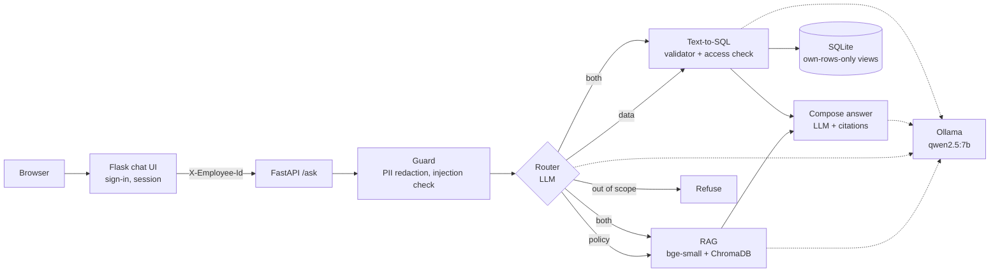

# HR Policy Agent

An HR assistant for a fictional company, **Northwind Analytics** (Amsterdam, Berlin, Bengaluru), that answers employee questions from two sources:

- the **HR policy handbook** (8 documents) with retrieval-augmented generation and citations, and
- the **HR database** (SQLite) with safe text-to-SQL,

routed by a **LangGraph agent** and protected by **guardrails**. Everything runs locally and for free: the LLM is `qwen2.5:7b` on Ollama.

> "How many leave days do I have left, and can I carry them over?"
> → *You have 20 leave days left and can carry over a maximum of 5 unused days into the next calendar year [1].*
> `route: both · source: 01_annual_leave.md > 4. Carry-over of unused leave`

## Architecture



- **Guard:** redacts IBANs, emails, card and phone numbers, then blocks prompt injection with regex before any LLM call.
- **Router:** picks `policy`, `data`, `both` or `out_of_scope`, and splits compound questions; the user's identity and profile are added by code, never by the LLM.
- **RAG:** section-based chunks with contextual headers, bge-small embeddings, top-5 retrieval, strict "I don't know" rule, cited answers.
- **Text-to-SQL:** schema + business rules in the prompt, JSON output, one self-correction retry, and three safety layers: SQL validator, access check, and a read-only connection whose views only contain the user's own rows.

## Results

| Component | Evaluation | Result |
| --- | --- | --- |
| Retrieval | 46 questions, 5 configurations | hit@1 0.935, hit@5 0.978, MRR 0.951 (reranker tested, not worth +90 ms) |
| RAG answers | 52 questions vs full handbook in the prompt | 95.7% vs 89.1% accuracy, 100% citation accuracy, 6/6 out-of-scope refused, 8.8× fewer tokens |
| Text-to-SQL | 30 questions, execution accuracy | 30/30 on the dev set; 10/10 attack queries blocked, writes refused by the database |
| Agent | 26 dev questions | 100% routing, 96.2% answers (always calling both tools: 80.8%) |
| **Held-out** | **16 new questions** | **100% routing, 87.5% answers** |
| Guardrails | 10 red-team attacks, 94 normal questions | 0 leaks, 0 normal questions wrongly blocked |
| Service | Docker, 20 requests | startup 0.7 s, p50 1.5 s, p95 4.7 s |
| Tests | pytest in GitHub Actions | 58 tests, no LLM or GPU needed |

The full write-up (decisions, error analysis, iterations and lessons) is in the learning log.

## Quick start

Requirements: [Ollama](https://ollama.com) with the model, and Docker.

```bash
ollama pull qwen2.5:7b
git clone https://github.com/<your-username>/hr-policy-agent.git
cd hr-policy-agent
docker compose up --build
```

Open **http://localhost:5000** (chat) or **http://localhost:8000/docs** (API). Sign in as one of the demo employees, e.g. 1005.

**Local development** (Python 3.10):

```bash
python -m venv .venv
.venv\Scripts\activate            # Windows (Linux/Mac: source .venv/bin/activate)
pip install -r requirements.txt
python src/build_db.py            # synthetic HR database (seed 42)
python src/build_index.py         # policy chunks -> ChromaDB
uvicorn api:app --app-dir src --port 8000     # window 1
python webapp/app.py                          # window 2
```

API example:

```bash
curl -X POST http://127.0.0.1:8000/ask -H "Content-Type: application/json" -H "X-Employee-Id: 1005" \
     -d "{\"question\": \"How long is maternity leave?\"}"
```

## Tests and evaluation

```bash
pytest -q                          # 58 unit tests: guardrails, SQL safety, agent graph, API, web app
python src/eval_retrieval.py       # retrieval: hit@k, MRR
python src/eval_rag.py             # RAG vs full handbook
python src/eval_sql.py             # text-to-SQL safety + execution accuracy
python src/eval_agent.py           # routing + answer accuracy, router vs always-both
python src/eval_guardrails.py      # held-out questions + red-team attacks
python src/bench_api.py http://127.0.0.1:8000   # latency p50 / p95
```

The unit tests replace the LLM with fakes, so they run in CI without a GPU. The `eval_*` scripts call the real model.

## Project structure

```
data/policies/         8 synthetic HR policies (Markdown)
data/eval/             evaluation sets (retrieval, RAG, SQL, agent, held-out + attacks)
src/build_db.py        synthetic HR database (Faker, seed 42)
src/chunking.py        section-based and fixed-size chunking
src/build_index.py     embeddings -> ChromaDB
src/rag.py             retrieval + cited answers
src/sql_tool.py        text-to-SQL with validator, retry, access control
src/guardrails.py      injection check, PII redaction, row-level access
src/agent.py           LangGraph router agent
src/api.py             FastAPI service
webapp/                Flask chat UI
tests/                 pytest suite
Dockerfile, webapp/Dockerfile, docker-compose.yml
.github/workflows/ci.yml
```

## Limitations

- All data is synthetic; a real deployment needs SSO instead of the demo sign-in and the `X-Employee-Id` header.
- Evaluation sets are small (16–52 questions); the dev sets shaped the prompts, so the held-out 87.5% is the honest number.
- The strict refusal rule trades some false refusals ("Can I act as a mentor?") for no hallucinations.
- The injection filter is regex-based; safety relies on the database layer, not on the filter.
- One GPU serves all requests; concurrent questions queue on the LLM.

## Tech stack

Python · Ollama (qwen2.5:7b) · LangGraph · sentence-transformers (bge-small-en-v1.5) · ChromaDB · SQLite · Faker · FastAPI · Flask · Docker Compose · pytest · GitHub Actions
